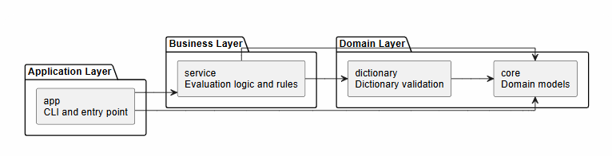

# Password Strength Analyzer

[](https://github.com/Alyemgul/password-strength-analyzer/actions/workflows/ci.yml)


A modular Java command-line application that evaluates password strength using rule-based and dictionary-based validation. Beyond the application itself, this repository demonstrates modern Java development practices including multi-module Gradle builds, automated testing, cross-platform CI/CD, and build automation.

---

## Quick Start

**Requirements**

- JDK 21
- Git

Clone and build:

```bash
git clone https://github.com/Alyemgul/password-strength-analyzer.git
cd password-strength-analyzer
./gradlew clean build
./gradlew :app:installDist
```

Run:

```bash
./app/build/install/app/bin/app --password "VeryStrong#Password2026"
```

Output:

```text
Strength: STRONG
```

> Windows users can replace `gradlew` with `gradlew.bat` and `app` with `app.bat`.

---

## Architecture

The project follows a layered, multi-module architecture that separates the command-line interface, business logic, and shared domain model.



| Module | Responsibility |
|---------|----------------|
| **app** | CLI and application entry point |
| **service** | Password evaluation engine and validation rules |
| **dictionary** | Dictionary lookup used by validation rules |
| **core** | Shared domain models |

Dependencies flow in one direction only, allowing the evaluation engine to remain independent of the user interface and easily reusable by another frontend (for example, a REST API).

---

## Continuous Integration

Every push and pull request triggers a two-stage GitHub Actions pipeline using a build matrix across **Ubuntu**, **Windows**, and **macOS**.

**Build**

- Compile the project
- Execute unit tests
- Generate JaCoCo coverage reports
- Upload test reports and coverage artifacts
- Publish the application distribution from the Ubuntu build

**Integration Test**

Runs only after the build stage succeeds (`needs: build`).

- Install the packaged application
- Execute Bash (Linux/macOS) and PowerShell (Windows) integration tests
- Validate CLI behavior using representative WEAK, MEDIUM, and STRONG password scenarios

---

## Technology Stack

- Java 21
- Gradle 9 (Version Catalogs)
- JUnit 5
- Mockito
- JaCoCo
- SLF4J
- GitHub Actions
- Bash
- PowerShell

---

## Testing

```bash
./gradlew test                  # Unit tests
./gradlew jacocoTestReport      # Coverage report
./scripts/integration-test.sh   # Integration tests (use .ps1 script on Windows)
```

---

## License & Attribution

Licensed under the Apache License 2.0. See the [LICENSE](LICENSE) file for details.

The application is based on an Apache-2.0 licensed educational starter project. This repository includes my own work on the multi-module Gradle configuration, package refactoring, build automation, GitHub Actions CI/CD pipeline, integration testing, code coverage configuration, project architecture, and documentation.